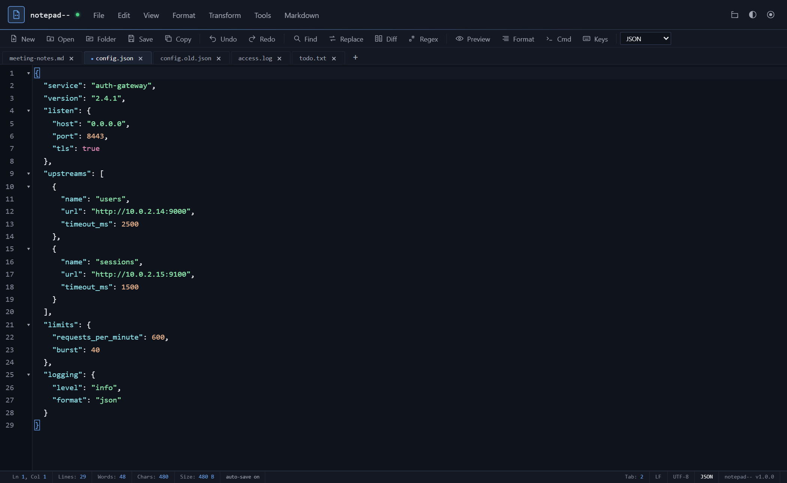
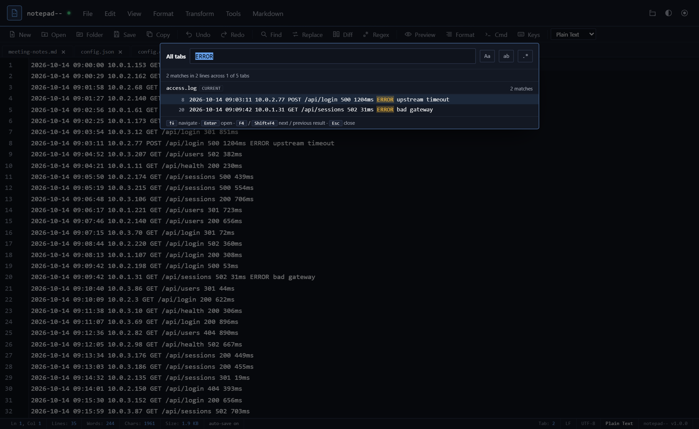
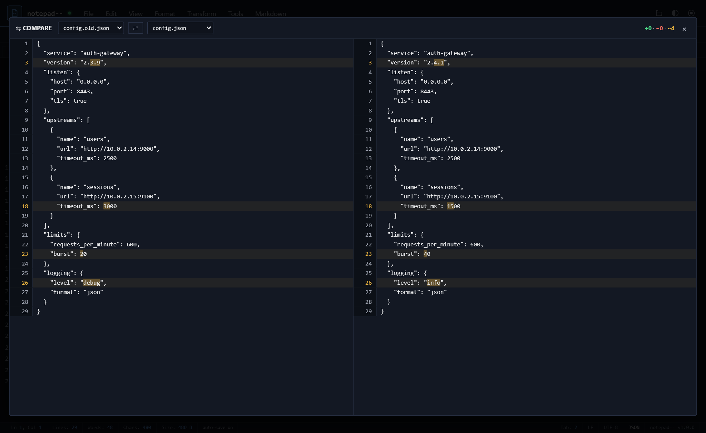
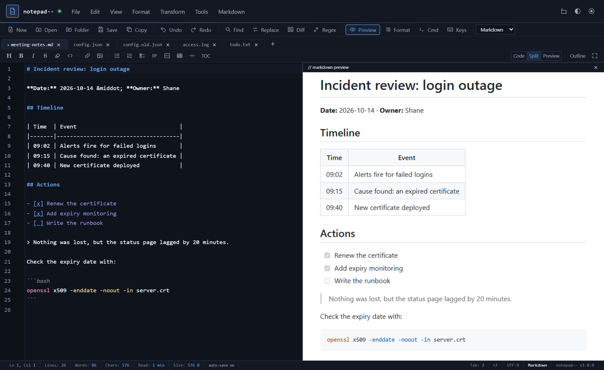
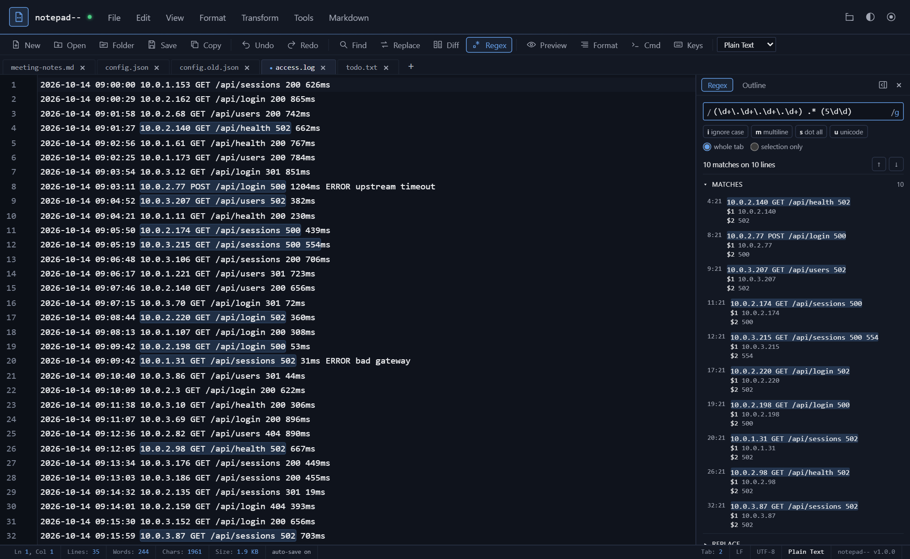
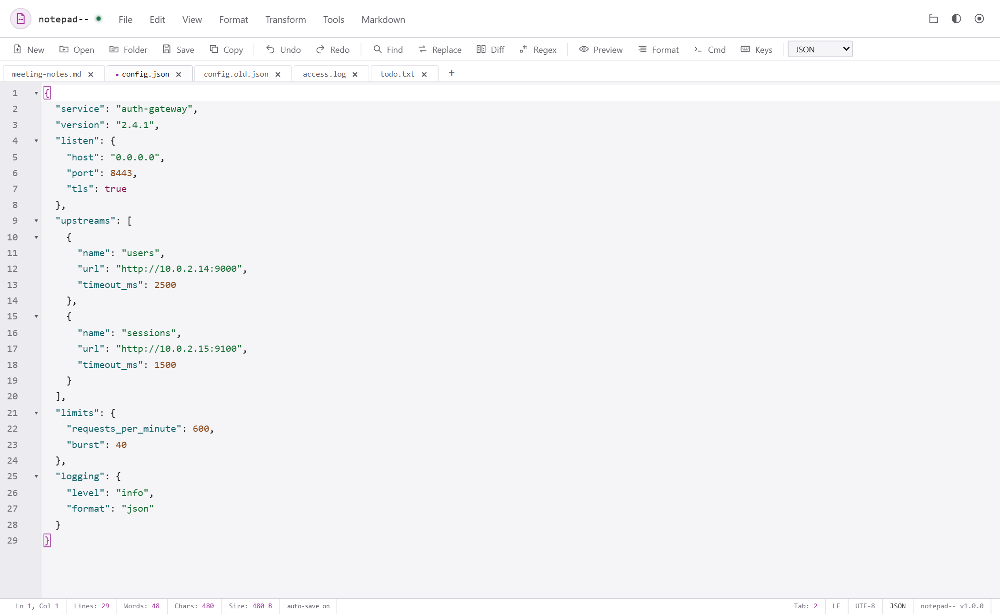
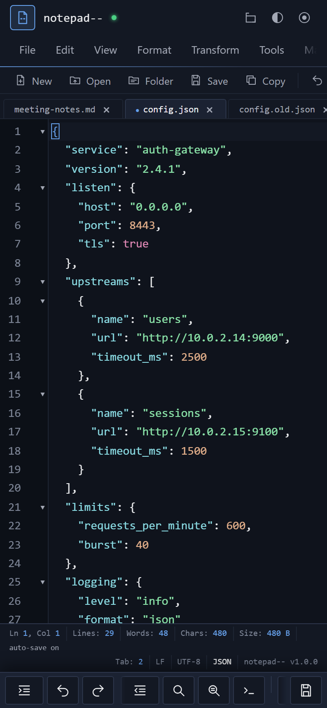

# notepad--

A local-only notepad and code editor that runs in the browser and installs as an app. Tabs, syntax
highlighting, a full Markdown editor with live preview, a regex lab, diff, split view and a pile of
text transforms, with notes kept in the browser and nothing uploaded unless you choose to share a
note through [scrt.link](https://scrt.link).

It uses the single-file-tool appearance system: design, mode and accent menus in the top bar, the
same as the other tools built from that template.

It is meant for the scratch work that usually ends up in a desktop text editor: pasting a log,
tidying some JSON, comparing two config files or keeping a running checklist, without installing
anything or sending the text anywhere. The editor, its language modes and the Markdown renderer
are all inlined into one page, so it loads nothing from any other site and keeps working offline.

Open `index.html` in a browser and it works, including from a file on disk. Put the folder on any
static host over https and the browser offers to install it as an app, which is also what makes
offline use and opening files from the OS possible.

## Features

- **Editing**: tabs with reopen-closed, sessions (save, restore, export and import sets of tabs),
  find and replace with regex, search across all tabs, line bookmarks (mark the lines that match,
  then keep, remove or copy them), go to line, command palette, multi-cursor, autocomplete, word
  wrap, zoom, tab size, and CRLF/LF line endings
- **Languages**: syntax highlighting for HTML, XML/SVG, CSS, JavaScript, TypeScript, JSON, Python,
  Markdown, SQL/KQL, Shell, YAML, PHP, Ruby, Go and Rust, and one-key formatting for JSON, JavaScript,
  CSS, HTML and Markdown
- **Markdown**: a formatting bar, smart lists, editor / split / preview views with sync scroll, an
  outline, a table of contents, templates, rich-text paste, and copy or export as HTML, rich text,
  `.md` or PDF
- **Regex lab**: a side panel that tests a pattern against the current tab as you type, with matches
  highlighted, capture groups, replace with a preview, a plain-English explanation and a cheat sheet
- **Views**: live HTML preview, side-by-side diff of two tabs, split view (clone the current file
  or open another tab, side by side or stacked, with optional sync scrolling), highlighting of the
  selected word elsewhere, visible whitespace, column rulers, and a sum of any numbers you select
- **Transform**: sort (also by length), shuffle, dedupe, reverse, number and trim lines, add a
  prefix or suffix, split and join, change case
- **Tools**: SHA hashes, JWT decoding, fang and defang of URLs, IPs and emails, UUIDs, Unix
  timestamps to dates and back, CSV to a Markdown table or JSON, Base64, URL, hex, HTML entity and
  JSON string encode and decode, and JSON minify
- **Files**: open files or a whole folder, save back to the same file, download, export Markdown to
  HTML, print or save as PDF
- **App**: installable PWA that works offline, opens `.txt`, `.md`, `.json`, `.csv`, `.yaml` and
  similar files from the OS, and accepts files shared to it on Android
- **Sharing**: optional one-off secret links through scrt.link, with your own API key if you have
  one, shown with a QR code for phones

## Using it

### Your notes are saved as you type

Every tab is autosaved to the browser a couple of seconds after you stop typing, and again the
moment you switch away or close the window. Reopen the page and your tabs, their contents,
languages and line endings are all back where you left them. The status bar shows `saved` after
each write. If the browser's storage fills up, it says so, and that is the point to save the big
tabs to files.

Open the app in two windows and they stay in step: when one saves, the other picks up the change,
unless it has unsaved edits of its own, in which case it warns you instead of overwriting.

**Sessions** (File menu) save the current set of tabs under a name, so you can switch between, say,
an incident's notes and a project's scratch files, and restore either later. Each session can be
exported as a `.json` file, or all of them at once, to back them up or move them to another
browser. **Import** adds the sessions from such a file alongside the ones you have, skipping any
that are already saved and renaming any whose name is taken.

### Opening and saving files

Open files with Ctrl+O, by dropping them onto the window, or, once installed, straight from the
OS. **Open Folder** shows a file tree in a side panel, so you can browse a project and open files
from it.

**Save** (Ctrl+S) writes back to the file you opened. The first save of a new tab asks where to
put it. That needs Chrome or Edge; other browsers download a copy instead. Folder access is Chrome
and Edge only too. **Save As** downloads a copy under a new name, and from then on Save no longer
writes to the original file. Each tab remembers whether its file used Windows (CRLF) or Unix (LF)
line endings and writes them back the same way, so opening and saving a file never quietly changes
them. The status bar shows the current ending, and clicking it switches.

Files are read as UTF-8, or as UTF-16 when they start with its byte order mark. A file that is not
valid UTF-8 is read as Windows-1252 rather than having its accented letters turned into `�`, and
the app says so; either way, saving writes UTF-8. Binary files are refused, and a file over 5 MB
asks first, because browser storage holds about that much and autosave stops working while one
that big is open.

### Finding things

Ctrl+F opens a find popup in the style of Notepad++, with match case, whole word and regex, and
Ctrl+H opens it on the replace side. Ctrl+Shift+F searches every open tab at once and groups the
results by tab; click one to jump there, or step through them with F4 and Shift+F4. Ctrl+G goes to
a line. Everything in the menus is also in the **command palette** (Ctrl+Shift+P): start typing
the name of a command and press Enter.

**Mark lines** in the find popup bookmarks every line with a match, as Notepad++'s Mark does. A
bookmark is a dot in the gutter beside the line number; click there, or press Ctrl+F2, to toggle
one by hand, and Alt+F2 / Alt+Shift+F2 jump to the next or previous. The Edit menu then removes
the bookmarked lines, or keeps them and removes the rest, each in one undo step; copies them;
inverts them; or clears them. So to keep only the errors in a log, find `ERROR`, Mark lines, then
Remove Unmarked Lines. With regex on, `^$` marks the blank lines. **Copy matches** copies just the
matched text, one match per line, such as every IP address in a log. Bookmarks move with their
lines as you edit and each tab keeps its own, for as long as the app is open.

### Preview, compare and split

**Preview** shows HTML rendered next to the source and updates as you type (Markdown has its own
views, below). It runs in a sandboxed frame, so a pasted page cannot reach your notes. The page
loads nothing from the network, so an image has to be inlined as a `data:` image; a link to a
picture on the web shows as a broken image. **Diff**
compares two tabs line by line, highlights the changed part of each changed line, and scrolls both
panes together.

 **Split** puts a second editor alongside the first, either another view of the same
file or a different tab, side by side or stacked. **sync scroll** in the bar at the top of the
split scrolls both panes together, line for line, keeping whatever offset they had when you turned
it on, so it works for two different files too. The choice is remembered.

### Writing Markdown

Set a tab's language to **Markdown**, or open a `.md` file, and a formatting bar appears under the
tabs: headings, bold, italic, strikethrough, highlight, inline code, links and images, bulleted,
numbered and task lists, quotes, code blocks, tables, a horizontal rule and a table of contents.
The buttons toggle, so pressing Bold on bold text takes it off again. Ctrl+B, Ctrl+I, Ctrl+E and
Ctrl+K do bold, italic, code and link, and Ctrl+1 to 6 set a heading level. In an installed app,
that is; in a browser tab, Ctrl+1 to 6 switch browser tabs instead.

Lists look after themselves: Enter at the end of an item starts the next one (numbered lists count
up, and a ticked task starts an unticked one), Enter on an empty item ends the list, and Tab and
Shift+Tab indent and outdent an item.

**Code**, **Split** and **Preview** on the right of the bar switch between the editor alone, the
two side by side, and the rendered page alone. Drag the divider to resize, or double-click it to
reset. In split view the two sides scroll together, and double-clicking anything in the preview
jumps the editor to its line. The preview is styled like GitHub and colours code blocks by
language. As on GitHub, HTML written in a note is cut down to a safe subset (details, kbd, images,
alignment and so on) with no scripts, forms or frames.

**Outline** lists every heading in a side panel; click one to jump there. **TOC** inserts a table of
contents linked to the headings, and running it again updates it in place. **Focus** hides
everything but the text, and Esc brings it back.

The **Markdown** menu has templates to start from (README, GitHub profile, blog post, changelog,
meeting notes, a cheat sheet and a feature tour) and every way to get the page out: copy it as HTML
or as rich text for Word, Outlook or Docs, download `.md` or a styled `.html`, or print to PDF.

Paste from a web page, Word or Google Docs and the formatting arrives as Markdown: headings, bold
and italic, links, lists, tables and code blocks. Paste a URL over selected text to turn it into a
link. Each of sync scroll, list continuation and rich-text paste can be switched off in the menu.

### Regex lab

**Regex** on the toolbar opens a side panel for building a regular expression against the tab you
are in. As you type, every match is highlighted in the editor and listed with its line, column and
capture groups; click one, or use the arrows (or Enter in the pattern box), to step through them.
The flags are toggles, and **selection only** limits the search to the text selected when you tick
it.

**Explain** breaks the pattern into its parts and says what each one does, in plain English.
**Cheat sheet** lists characters, anchors, sets, repeats, groups, lookarounds, Unicode classes and
replacement tokens, each a click away from being inserted at the cursor, plus ready-made patterns
for emails, URLs, IPv4 and IPv6 addresses, MAC addresses, dates, times, timestamps, GUIDs, key=value
pairs, repeated words, trailing spaces and more. **Replace** previews the first few replacements,
with `$1`, `$<name>` and `$&` expanded, then replaces them all in one undo step. **Lines** has
the same Mark lines and Copy matches as the find popup, for the pattern and scope in the panel, and
the buttons to keep, remove, copy, invert or clear the bookmarked lines. **Use in Find** hands the
pattern to the Find and Replace popup, and recent patterns are kept for next time.

The regex and outline panel opens on the right. The arrow button in its header moves it to the
left of the editor, and back, and the side you choose is remembered.

The pattern runs in a background worker with a time limit, so one that backtracks badly on your
text (the classic `(a+)+$`) is stopped with an explanation instead of freezing the editor. Regex
searches in Find and Replace and in Search in All Tabs go through the same worker.

### Transforms

The Transform menu works on the selection, or on the whole document when nothing is selected: sort
lines (A to Z, Z to A, numerically or by length), shuffle them, remove duplicates or blank lines,
keep only the lines that appear once, reverse, number the lines, add a prefix or suffix to each
(say `'` and `',` to turn a list into SQL), split or join lines, change case and trim trailing
spaces.
**Format** (Shift+Alt+F) pretty-prints JSON, JavaScript, CSS and HTML (including its script and style
blocks) using the current tab size. On Markdown it tidies the layout without touching the content:
headings, blank lines around blocks, trailing spaces (hard breaks are kept) and table alignment. Code
blocks, front matter and HTML are left as they are. Every transform and format is a single undo step.

### Tools

- **Hashes** shows the SHA-1, SHA-256, SHA-384 and SHA-512 of the selection, or of the whole tab
  as it would be saved (with its own line endings, so it matches `sha256sum` on the file). Click
  one to copy it.
- **Decode JWT** finds a token in the selection or the tab (a `Bearer` header is fine) and opens
  its header and payload in a new tab, with `exp`, `iat` and `nbf` shown as dates and how long ago
  or ahead they are. The signature is not checked.
- **Defang** makes indicators safe to share, as threat reports do: `https://evil.example/x`
  becomes `hxxps[://]evil[.]example/x`, IP addresses become `10[.]0[.]0[.]1` and emails
  `a[@]evil[.]example`. Only the host's dots change, so paths stay readable, and running it twice
  changes nothing. **Fang** turns it all back, and also reads the other common spellings (`(.)`,
  `{.}`, `[dot]`, `hXXp`, `[:]`, `[at]`). Bare domains without `http://` or `www.` are left
  alone, so file names and version numbers are not touched.
- **Insert UUID** puts a new random (v4) UUID at every cursor.
- **Unix Timestamps → Dates** turns 10-digit (seconds) and 13-digit (milliseconds) timestamps into
  ISO 8601 dates in UTC, and **Dates → Unix Timestamps** does the reverse. A date with no time
  zone is read as local time.
- **CSV → Markdown Table** and **CSV → JSON** read CSV, TSV or semicolon-separated text, with
  quoted fields, and open the result in a new tab, or replace the selection if there is one.
- **Encode and decode** Base64, URLs, hex, HTML entities and JSON strings, and **minify JSON**. Like
  the transforms, these work on the selection or the whole tab, each in one undo step.

Everything runs in the page; nothing is sent anywhere.

### Appearance

The three buttons at the right of the top bar set the design, the mode (dark, dusk, sepia or
light) and the accent colour, which can be any colour. The choice is remembered, and the editor's
syntax colours are adjusted for each mode so code stays readable in all of them.

The View menu has a few more, also remembered. **Highlight Occurrences** (on by default) marks
every other place a selected word appears, like Notepad++'s smart highlighting. **Show
Whitespace** draws spaces as dots and tabs as arrows, and tints whitespace at the end of a line.
**Column Rulers** draws guides at the columns you give, say 80 and 120. **Scroll Past End** (on)
lets the last line scroll up to the top. When you select a run of numbers, such as a column from
a log, the status bar shows their sum; hover for the count, average, minimum and maximum, and
click to copy them. HTML and XML tags close themselves as you type them. With **Line Numbers**
off, the gutter closes up unless the tab has bookmarks or a language that folds.

### On a phone or tablet

On a narrow or touch screen, a row of large buttons appears above the keyboard for the things a
phone keyboard lacks: indent and unindent, undo and redo, save, find, search all tabs and the
command palette. Tabs can be reordered with a long press and drag. Installed on Android, notepad--
appears in the share sheet, so text or files shared from another app open in a new tab.

### Sharing a note

**Share via scrt.link** (File menu) shares the selection, or the whole tab if nothing is selected,
as a one-time secret link. With a scrt.link API key saved and sharing turned on in **scrt.link
Settings**, the app creates the link itself, with an expiry of an hour, a day, a week or 30 days
and an optional password. It shows the link with a QR code of it underneath, so a phone can open
the secret by scanning the screen; the code is drawn in the page and never leaves it. Otherwise it
copies the text and opens scrt.link for you to paste it, which on the free tier takes up to 150
characters. Nothing is sent anywhere unless you use this.

## Keyboard shortcuts

A few of the most useful. Keys lists them all.

| Action | Keys |
|---|---|
| New tab / close tab / reopen closed tab | Ctrl+N / Ctrl+W / Alt+Shift+T |
| Open / save / save as | Ctrl+O / Ctrl+S / Ctrl+Shift+S |
| Find / replace / go to line | Ctrl+F / Ctrl+H / Ctrl+G |
| Search all tabs, then step through results | Ctrl+Shift+F, then F4 / Shift+F4 |
| Toggle bookmark / next / previous | Ctrl+F2 / Alt+F2 / Alt+Shift+F2 |
| Command palette | Ctrl+Shift+P |
| Select next occurrence / add a cursor | Ctrl+D / Ctrl+Click |
| Duplicate / delete / move line | Ctrl+Shift+D / Ctrl+Shift+K / Ctrl+Shift+Up or Down |
| Toggle comment | Ctrl+/ |
| Format JSON | Shift+Alt+F |
| Insert date / time / both | Alt+Shift+D / H / N |
| Word wrap | Alt+Z |
| Move tab left / right | Ctrl+Shift+PgUp / PgDn |
| Markdown: bold / italic / inline code / link | Ctrl+B / Ctrl+I / Ctrl+E / Ctrl+K |
| Markdown: heading level | Ctrl+1 to Ctrl+6 |

## Privacy and security

Notes live in the browser's `localStorage` and never leave the device. The only network call the
app can make is to `https://scrt.link`, and only when you create a scrt.link secret. The Content
Security Policy in the page enforces that (`connect-src 'self' https://scrt.link`, and images,
styles, fonts and media only from the page itself), and `_headers` and `.htaccess` carry the same
policy for hosts that read them. A scrt.link API key, if you save one, is kept in the same
`localStorage` as the notes, as plain text, so only save it on a browser you trust.

A note can come from anywhere (a file, something shared to the app, a paste), so its content is
treated as untrusted:

- Markdown is rendered to HTML and then sanitised before it is previewed, copied, printed or
  exported: only a fixed set of tags and attributes survive, links must be http, https or mailto,
  and a style attribute is dropped if it could fetch anything. The preview runs in a sandboxed frame with no access to the app, under its own policy
  that lets only the preview's own script run, and it ignores messages that don't carry that
  frame's key. Printed and exported pages carry a policy that allows no script at all.
- HTML previews run the page you wrote, but in a sandboxed frame that can't reach your notes.
- Names of shared and opened files lose control and right-to-left characters, which could
  otherwise disguise an extension.
- A regex that backtracks badly is stopped by a time limit instead of freezing the page.
- The service worker only caches the app itself, so opening other files from the same site (this
  README, say) can't replace the offline copy.

The libraries are bundled into the page, so nothing is loaded from a CDN, and every push is
checked for secrets, for any script or stylesheet loaded from another site, and for a missing
Content Security Policy.

## Repository layout

The repository is the app, ready to serve as it is.

| Path | What it is |
|---|---|
| `index.html`, `manifest.webmanifest`, `sw.js`, `icons/`, `vendor/` | The app. `vendor/` holds the scrt.link client, loaded only when you share |
| `_headers`, `.htaccess` | Security headers for Netlify / Cloudflare Pages and Apache. GitHub Pages ignores them; the page's own CSP still applies |
| `.nojekyll` | Tells GitHub Pages to serve the files as they are |
| `docs/` | The screenshots in this README |
| `.github/workflows/checks.yml` | The shared static checks that run on every push |

## Third-party code

Bundled into the page, each under the MIT licence with its notice kept:

- [CodeMirror 5.65.16](https://codemirror.net/5/)
- [marked 9.1.6](https://marked.js.org/)
- [js-beautify 1.15.1](https://github.com/beautifier/js-beautify)
- [@scrt-link/client 0.0.11](https://www.npmjs.com/package/@scrt-link/client)

## Licence

No licence has been chosen yet, so all rights are reserved for now.
